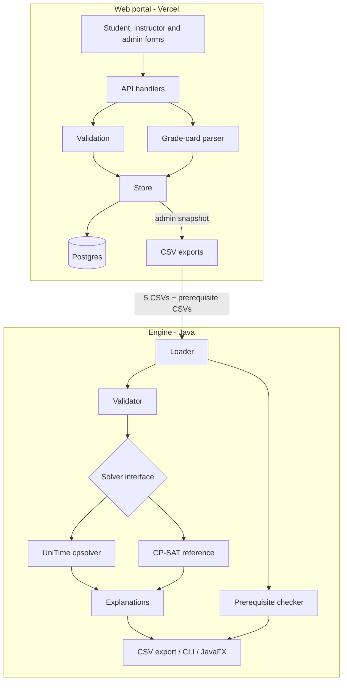

# Design Document: IITM Explainable Slotbook

| | |
|---|---|
| **Course** | CS5013, project |
| **Authors** | Nishanth S (EE23B049), Sparsh Gupta (EE23B117) |

> A three-page version, typeset in LaTeX, is in [`docs_design/design.pdf`](docs_design/design.pdf) ([source](docs_design/design.tex)).
>
> **Note on this document.** This document was written up on 5 November 2026, reconstructed from the project's prompt log (P001–P017), its commits and its per-version docs. It sets out the design decisions the team made between 10 October and 4 November 2026, in the form of the upfront design they amount to. It uses planning voice ("we will"). The decision log in §13 dates each decision to the prompt where it was actually made, and the appendix maps each requirement to the code and tests that satisfy it.

---

## 1. Background

Each semester, an IITM department assigns every course a lecture slot on the institute timetable grid (slots A–H, J–M, P–T, plus lab slots). Today this is done by hand from the previous year's slotbook. The reasoning behind each choice ("Prof X can't teach Monday mornings", "these two core courses must not clash for third-years") lives in people's heads and email. When a slot changes, nobody can say why, and when a clash appears, nobody can say what it would cost to fix.

The problem has three properties that shape the design:

1. **It is a constraint problem.** Some rules can never be broken: a course and its own lab must not overlap, and an instructor can't teach two lectures at once. Other wishes have a cost, such as an instructor's preferred slots, stability from last year, and fewer student clashes.
2. **Trust matters more than optimality.** A timetable nobody can explain won't be adopted, even if it's optimal.
3. **The inputs are scattered.** Student course choices and instructor preferences have to be collected before anything can be solved.

## 2. Goals and non-goals

### Goals

- **G1.** Produce a complete slotbook that never violates a hard rule, and minimises a documented penalty for soft preferences.
- **G2.** Explain every assignment: why this slot, and why each other slot was rejected or cost more.
- **G3.** Be reproducible: the same input gives the same output and the same explanations.
- **G4.** Collect student and instructor preferences through a web portal, and export them in the engine's input format.
- **G5.** Warn when a student ranks a course whose prerequisites they haven't completed.
- **G6.** Demonstrate disciplined, AI-assisted engineering: logged prompts, reviewed output, tests that try to break the system, and traceable commits.

### Non-goals

These are out of scope for this course project. Each may become a goal later.

- **NG1.** Using a language model to choose or explain slots. Every decision and every explanation comes from the model and its constraints.
- **NG2.** Room allocation. Each course keeps its room, and capacity is assumed sufficient.
- **NG3.** Institutional login and access control. The demonstration portal is labelled as having no authentication.
- **NG4.** Enforcing prerequisites. A department can waive them, and self-reported records are not proof, so the system warns but never blocks (§6.6).
- **NG5.** Real student data in the repository. All fixtures are synthetic.
- **NG6.** Running the Java solver inside the web host. The portal exports files, or calls an external solver endpoint.

## 3. Users and use cases

| User | Use case |
|---|---|
| **Timetabler** (department) | Solve a dataset, compare solvers, read explanations, export the slotbook |
| **Student** | Rank up to 10 courses; upload a grade card; see prerequisite warnings |
| **Instructor** | Give slot penalties with reasons; declare prerequisites for their course |
| **Administrator** | Monitor submissions and warnings, export solver inputs, publish the result |
| **Anyone** | View the published slotbook and its explanations |
| **Evaluator / maintainer** | Trace any result to code, tests and the prompt that produced it |

## 4. Requirements

### 4.1 Functional

| ID | Requirement |
|---|---|
| **FR1** | Read five CSV inputs: courses, slots, hard conflicts, instructor preferences, student preferences. |
| **FR2** | Validate all inputs before solving. Report every problem with a specific code (e.g. `FIXED_CONFLICT`, `UNKNOWN_SLOT`) and never solve invalid input. |
| **FR3** | Assign every course exactly one lecture slot from its allowed set, or its fixed slot. |
| **FR4** | Enforce the hard rules: no lecture over the course's own lab; no overlap between protected course pairs; no instructor teaching two overlapping meetings; no two lectures in the same room at once. |
| **FR5** | Compute overlaps from real meeting times on the official IITM grid, not from slot letters. |
| **FR6** | Minimise the objective in §6.3. |
| **FR7** | Produce a deterministic explanation per course: rules satisfied, penalties paid, and each alternative slot classified as rejected (with the rule) or feasible (with its estimated cost). |
| **FR8** | Export `generated_slotbook.csv` and `assignment_explanations.csv`. |
| **FR9** | Provide a CLI for headless runs and a desktop view for inspection. |
| **FR10** | Provide portal forms for students and instructors, an admin dashboard and a public results page. |
| **FR11** | Export portal data in exactly the CSV schemas of FR1. |
| **FR12** | Let instructors declare prerequisites, let students upload a PDF grade card, and report missing prerequisites as warnings in the portal and the CLI, with identical results in both. |
| **FR13** | Report infeasible input with diagnostics, never with a partial timetable presented as complete. |

### 4.2 Non-functional

| ID | Requirement | Measure |
|---|---|---|
| **NFR1** Explainability | Each explanation must be derivable from the model alone | No solver internals in explanations; identical explanations for every solver |
| **NFR2** Correctness | Hard rules must hold on every output | Checked by an independent constraint checker, not by the solver's own report |
| **NFR3** Reproducibility | Same input, same output | Fixed seeds; a single worker for CP-SAT demonstrations |
| **NFR4** Scale | A department-sized problem (tens of courses, hundreds of students) solves in seconds | A default 10 s time limit; documented comparison against an exact solver |
| **NFR5** Data integrity | Stored portal data always satisfies the solver's input rules | Validation in code **and** database constraints; one transaction per replacing write |
| **NFR6** Concurrency | Simultaneous submissions must neither fail nor corrupt data | Tested with hundreds of concurrent requests against a real database |
| **NFR7** Privacy | Store the minimum | Grade-card PDFs never stored; only course, grade and term kept |
| **NFR8** Security | No secrets in code or browser; no SQL injection | Parameterised queries only; constant-time admin password check |
| **NFR9** Cost | Runs on free tiers | Vercel Hobby, Neon Free |
| **NFR10** Maintainability | A new team member can change a rule safely | Small modules with one-way dependencies; tests named after behaviour |

## 5. Constraints and assumptions

- Java 17, Maven, JUnit 5 for the engine; Node.js 22 for the portal (the PDF library requires it).
- The slot grid comes from the official IITM timetable page and is cited in the data.
- Student and instructor data are synthetic until NG3 is lifted.
- Free-tier hosting: Vercel serverless functions are short-lived and have no persistent disk, so storage must be external (NFR9).

## 6. Proposed design

### 6.1 Architecture

The data flow is one-way: input, validate, solve, explain, export. The engine's packages depend on each other in one direction only. `model` (immutable records) depends on nothing, and `io`, `validation`, `solver` and `explain` depend on `model`. The CLI and the JavaFX view share one service, so neither contains solver logic.

### 6.2 Data model

The engine's contract is five CSV files; their schemas are in the [manual](MANUAL.md#input-files). We choose CSV because timetablers already work in spreadsheets, files can be reviewed in a diff, and the portal can produce them exactly (FR11). Two optional files, `prerequisites.csv` and `completed_courses.csv`, add the prerequisite data without changing the required five.

### 6.3 Objective

We minimise one documented penalty, defined in a single `Objective` class that every solver and the explanation builder share:

| Term | Cost |
|---|---|
| Instructor penalty for the chosen slot | As given by the instructor (0–100); **1** when they gave no preference for that slot |
| Moving a course away from its historical slot | **2** |
| Students taking both courses of an overlapping pair | pair weight × overlapping meetings × **3** |

A pair's weight sums, over every student who chose both courses, `max(1, 4 − worse rank)`. A clash between two first or second choices therefore costs more than one involving a seventh choice, and every shared choice still counts at least 1.

The weights are deliberately small integers that can be explained in a sentence. Student clashes weigh most, and stability least. Because one class defines the objective, a solver's reported score can be checked against an independent recomputation (NFR2).

### 6.4 Solver strategy

We will put solvers behind a `TimetableSolver` interface, and build them in two steps:

1. **CP-SAT reference (OR-Tools).** An exact model: one Boolean per course and slot, hard rules as constraints, and student clashes linearised with the full AND encoding. It can prove optimality on small inputs, which makes it the yardstick.
2. **UniTime cpsolver as the default.** cpsolver is the course-timetabling engine of the UniTime system: iterative forward search, then hill climbing and great deluge. It scales to real university problems. We will use the library from Maven Central, not a UniTime server. We will map our problem onto its model, and check that its score equals our objective on every test input.

Keeping CP-SAT after UniTime becomes the default is deliberate. Every generated scenario is solved by both, so the heuristic's gap from the proven optimum is measured, not assumed.

### 6.5 Explanations

Explanations are computed after solving, from the problem and the chosen assignment alone. For the chosen slot we list the satisfied rules and the penalties paid. For every other allowed slot we either name the hard rule it would break, or give its estimated cost. That cost is local: it is the change in objective if only this course moved, and it is labelled as an estimate. The same code serves both solvers, so explanations can't drift between them (NFR1).

### 6.6 Prerequisites

- **Rules.** Instructors declare prerequisites for their course on the portal. One rule is "course X expects course Y completed".
- **Completions.** We start with a student-uploaded PDF grade card. The parser rebuilds table rows from text positions and reads the term, course, grade and year by column. Grades U (fail), W (withdrawn) and I (incomplete) do not count as completed; a retaken course counts if any attempt passed. The PDF is discarded after parsing (NFR7).
- **Extension point.** Completion sources are a small registry. A future `admin` source, with records supplied by the academic section, plugs in without a schema or form change, and becomes the verified path.
- **Warnings, not enforcement (NG4).** A missing prerequisite produces a warning at submission, on the admin dashboard and in the CLI. Submissions are never blocked, and the solver's input never changes. Prerequisite data is kept outside the solver's problem object, so this is guaranteed by construction and checked by a test.
- **One rule, two implementations.** The portal (JavaScript) and the CLI (Java) implement the same rule. A shared golden file of expected warnings is checked by both test suites, so they can't diverge.

### 6.7 Portal and storage

The portal is static pages plus serverless API functions on Vercel, in four layers:

- **HTTP handlers** parse requests and map errors to status codes;
- **validation** is pure functions;
- **domain** covers grade cards and prerequisites;
- **a store** is the only module that issues SQL, and every query is parameterised.

Storage follows a **phased plan**:

| Phase | Store | Why | Move on when |
|---|---|---|---|
| Demonstration | Google Sheet via Apps Script | Free, no setup, staff can read it directly | Relational rules, concurrent writers or prerequisites are needed |
| Production-shaped | **Postgres on Neon** | Foreign keys and CHECK constraints mirror the validation rules; transactions; free tier with an official Vercel integration; standard `pg` driver keeps it portable | — |

Schema changes are numbered SQL migrations, each applied once in its own transaction. Replacing a submission is one transaction. When writers share no row (two instructors updating one course's prerequisites), a per-course transaction lock makes them take turns.

### 6.8 Error handling

| Situation | Behaviour |
|---|---|
| Invalid engine input | Every issue reported with a code; exit status 1; no solve |
| Usage error (unknown option, missing file) | Exit status 2 |
| Invalid portal input | 400 with the validation message |
| Bad or unreadable grade card | Warning; the submission still saves |
| Solver endpoint failure | 502 with the solver's message |
| Missing configuration | 503 naming the variable |
| Anything else | Logged in full; the client sees only "Unexpected server error" |

We only translate errors we understand. In particular, a PDF-library failure must not be reported to a student as "your file is bad".

## 7. Alternatives considered

| Decision | Options | Choice and reason |
|---|---|---|
| Solving approach | Hand-written greedy heuristic; MIP; CP-SAT; full UniTime server; cpsolver library | **CP-SAT first, then cpsolver as the default.** CP-SAT gives proofs on small inputs. cpsolver gives proven scale without running a server. A hand-written heuristic would be neither provable nor proven. |
| Explanations | LLM-generated text; solver logs; recomputation from the model | **Recomputation.** It is deterministic and checkable, and works the same for every solver. An LLM could state a reason that isn't true (NG1). |
| Time model | Treat equal slot letters as clashes; real minute grid | **Real minutes.** Lab and lecture slots with different letters do overlap in practice. |
| Interface | Web only; desktop only; CLI only | **CLI plus JavaFX for the engine, and a web portal for collection.** The CLI makes CI and reproducibility easy; the desktop view helps inspection; collection needs the web. |
| Portal storage | Files on Vercel; Google Sheets; Postgres (Neon); Supabase; SQLite (Turso) | **Sheets for the demonstration, then Neon Postgres** (§6.7). Vercel's disk is ephemeral. Supabase adds auth and storage we don't need yet. SQLite has weaker constraints for this use. |
| Prerequisites | Enforce (reject); warn; ignore | **Warn** (NG4). |
| Grade-card parsing | Client side; server side | **Server side.** One implementation, testable in Node. A self-upload is unverified either way, so client-side parsing adds no trust. |
| Parity between portal and CLI | Call Java from Node tests; shared golden file | **Golden file.** Each CI job stays single-language, and the contract is a file a reviewer can read. |

## 8. Test strategy

We test against **independent oracles**, not the code under test:

| Level | What | Oracle |
|---|---|---|
| Unit | Parsers, validators, objective, explanations, grade-card rows, prerequisite rule | Hand-computed cases; one test per validation code |
| Solver correctness | Both solvers on fixtures and generated scenarios | An independent constraint checker and penalty calculator; exhaustive brute force on small seeds |
| Cross-solver | UniTime against CP-SAT on every scenario | CP-SAT's proven optimum; the gap is recorded |
| Contract | Portal exports against the Java loader's headers; portal against CLI warnings | Repository fixtures; a shared golden file |
| Integration | Store on real Postgres: rollback, concurrency, constraints | Database state after the operation |
| Stress | Seeded fuzzing of all inputs, corrupted PDFs, volume against a naive oracle, linear-scaling checks, hundreds of concurrent requests | Invariants (never a 500; whole submissions only) and naive re-implementations |
| Manual | JavaFX view; portal pages in a real browser, console errors included | Checklist in the test plan |

We will follow four rules:

- Never assert one exact timetable when several are optimal.
- Make every random test seeded and replayable.
- Re-run a regression test against the old code to show it fails there.
- List every test in the [test plan](docs_v3/TEST_PLAN.md).

CI runs everything on each push and pull request: the Java suite, the portal suites with a Postgres service, CLI demonstrations with both solvers, and a man-page lint.

## 9. Engineering process

- **Prompts before code.** Each piece of AI-assisted work starts with an entry in [`prompts/PROMPT_LOG.md`](prompts/PROMPT_LOG.md). An entry has the original request, a CoSTAR restatement, and **negative constraints** grouped by origin: stated by the developer, agreed in planning, or added at review. Entries end with review notes and acceptance evidence.
- **Clarify before building.** Broad requests get a few concrete questions first: which database, enforce or warn, where data comes from.
- **AI output is untrusted until verified.** Review means running the tests and the checks, and recording what was rejected and why.
- **Small commits, each passing tests,** referencing their prompt. Larger changes go through a pull request with CI.
- **Debugging is recorded:** reproduce, observe, hypothesize, isolate, correct, test, regress, lesson.
- **Documentation is versioned** (`docs_v1`, `docs_v2`, `docs_v3`), with a manual and a `slotbook(1)` man page whose rendering CI keeps current.

## 10. Milestones

| Milestone | Scope | Exit criteria |
|---|---|---|
| **M1: Engine v1** | Architecture, synthetic fixtures, CP-SAT model, explanations, CLI, JavaFX, CI | Feasible fixture solves; infeasible fixture reports `FIXED_CONFLICT`; hard rules hold on every output |
| **M2: Testing framework** | Independent oracles, generated scenarios, brute force | CP-SAT matches the exhaustive optimum on every seed |
| **M3: Engine v2** | UniTime cpsolver as default; real IITM times, rooms and labs | UniTime's score equals the objective; its gap from CP-SAT is measured and documented |
| **M4: Portal (demonstration)** | Forms, admin, results, Sheets storage | Exports match the Java schemas byte for byte |
| **M5: Mid-evaluation** | Showcase dataset, three-page practices PDF, viva pack | Live demonstration and live code modification rehearsed |
| **M6: v3** | Postgres storage; prerequisites with grade cards; man page; docs_v3 | Portal and CLI warnings equal the golden file; integration tests pass on real Postgres |
| **M7: Hardening** | Stress testing; deployment | No 500s under fuzzing or concurrency; deployed with `/api/health` reporting a configured database |

## 11. Risks and mitigations

| Risk | Likelihood | Impact | Mitigation |
|---|---|---|---|
| The heuristic misses the optimum | Medium | Medium | Keep CP-SAT as a reference; measure the gap on every scenario; document it |
| Our objective differs from UniTime's score | Medium | High | Map penalties explicitly; test that the scores are equal |
| Explanations contradict the solution | Low | High | Derive explanations from the model alone; check them for every course |
| Synthetic data is mistaken for real data | Medium | Medium | Label provenance in data, UI and docs (NG5) |
| Real grade cards leak into the repository | Low | High | Synthetic fixtures carry a marker; a static check rejects any PDF without it |
| A self-reported grade card is false | High | Low | Warnings only; a verified `admin` source is planned |
| Concurrent submissions corrupt data | Medium | High | Transactions, database constraints, per-course locks; concurrency stress tests |
| Hostile uploads exhaust CPU | Low | Medium | 3 MB limit; linear algorithms; scaling checks in tests |
| A dependency needs a newer runtime | Medium | Medium | Declare runtime versions (`engines`); CI on the deployed version |
| No authentication in the demonstration | Certain | High if real data | Label it; collect no real data until IITM login, consent and retention rules exist (NG3) |

## 12. Open questions

1. Who supplies verified completion records, and in what format? This decides the `admin` source.
2. Should some prerequisites ever block a submission (e.g. for core courses), with an override? That would be a policy change to NG4.
3. Should room allocation join the model (NG2), and where would room capacities come from?
4. Is the rank weighting in §6.3 (`max(1, 4 − worse rank)`) right? It treats every choice from the third down alike. Real choice data would let us test whether students mind clashes between lower-ranked choices less.
5. What do we need before real data (NG3): IITM single sign-on, consent text, a retention period, admin roles?

## 13. Decision log

| Decision | Made in |
|---|---|
| Modular Maven project; deterministic explanations; no LLM in the decision path; no auth or deployment in the first scope | P001 |
| Synthetic fixtures with a separate infeasible fixture | P002 |
| CP-SAT model with the full AND linearisation; fixed seed and one worker | P003 |
| Tests target invariants, not one exact timetable | P004 |
| Independent oracles, generated scenarios and brute force | P008–P010 |
| UniTime cpsolver as default, CP-SAT kept as reference; real IITM times | P006, P011 |
| Portal on Vercel with Google Sheets for the demonstration | P012 |
| Postgres on Neon; prerequisites as warnings; grade-card source with an admin extension point | P015 |
| Stress testing; per-course locking; linear grade-card parsing | P017 |

## Appendix: requirement traceability

| Requirement | Built in | Verified by |
|---|---|---|
| FR1 | `io/DatasetLoader`, `io/CsvSupport` | `DatasetLoaderTest`, `CsvSupportTest` |
| FR2 | `validation/InputValidator` (18 issue codes) | `InputValidatorTest` |
| FR3, FR4 | `solver/unitime/`, `solver/OrToolsTimetableSolver` | Both solver test classes; `testing/ConstraintChecker` oracle (in `src/test`) |
| FR5 | `model/TimeGrid` | `timeGridUsesRealMinutes` |
| FR6 | `solver/Objective`, `model/TimetableProblem` (pair weights) | `testing/PenaltyCalculator` oracle; `uniTimeObjectiveEqualsTheSlotbookPenalty` |
| FR7 | `explain/` | `emitsOneCompleteExplanationPerCourse` (both solvers) |
| FR8 | `io/SlotbookExporter` | `SlotbookExporterTest` |
| FR9 | `cli/SlotbookCli`, `ui/SlotbookApplication` | CLI runs in CI; manual JavaFX checklist |
| FR10, FR11 | `portal/api`, `portal/public` | `portal/tests/api.test.mjs`; `npm run check` header check |
| FR12 | `portal/api/_gradecard.js`, `_prerequisites.js`, `validation/PrerequisiteChecker` | `gradecard`, `prerequisites` and `parity` tests; `PrerequisiteWarningsDatasetTest` |
| FR13 | Validator and solver diagnostics | `rejectsKnownInfeasibleFixtureBeforeSolving` |
| NFR2 | `testing/ConstraintChecker` (test code, independent of the solvers) | Generated scenarios on both solvers |
| NFR5, NFR6 | `portal/db/migrations`, `api/_store.js` | `tests/integration`, `tests/stress/postgres.stress.mjs` |
| NFR7, NFR8 | `_gradecard.js`, `_store.js`, `_lib.js` | `npm run check` fixture and secret checks; stress fuzzing |

Detail: [manual](MANUAL.md), [architecture](docs_v3/ARCHITECTURE.md), [test plan](docs_v3/TEST_PLAN.md), [functionality and progress](FUNCTIONALITY_AND_PROGRESS.md).
