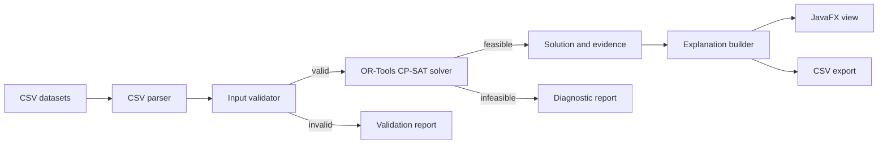

# Architecture

## Dependency rule

`model` contains immutable domain records. `io` translates CSV rows into those records. `validation` rejects malformed or contradictory input. `solver` owns all optimization logic. `explain` converts solver evidence into deterministic user-facing reasons. `ui` and `cli` depend on the application service and never construct solver variables directly.

This separation makes live modifications local and testable: changing a constraint should normally affect the solver and its tests, while changing presentation should affect only UI/export code.

