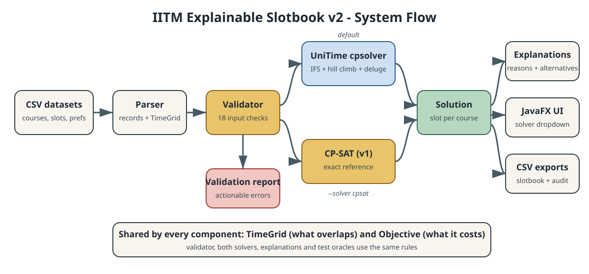
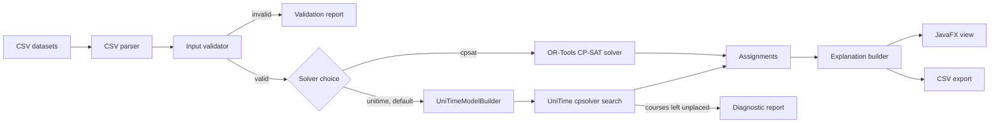

# Architecture (v2)

## Packages

| Package | Responsibility |
|---|---|
| `model` | Immutable domain records, plus `TimeGrid`, the single definition of what counts as a clash |
| `io` | CSV rows to records, and results back to CSV |
| `validation` | Rejects malformed or contradictory input before any solver runs |
| `solver` | The `TimetableSolver` interface, the shared `Objective` weights, `SolverChoice`, and the v1 CP-SAT solver |
| `solver.unitime` | The UniTime wrapper: `UniTimeModelBuilder` (slotbook to UniTime) and `UniTimeTimetableSolver` (search, then UniTime back to slotbook) |
| `explain` | Deterministic reasons computed from the problem and the final assignment only |
| `service` | One run: load, solve, return |
| `cli`, `ui` | Thin adapters; they pick a solver through `SolverChoice` and never touch solver variables |

## Dependency rule

`model` depends on nothing. `validation`, `explain` and both solvers depend on `model`, and all of them use `TimeGrid` and `Objective`, so the solvers, the explanations and the test oracles cannot disagree about what an overlap or a penalty is. Only `solver.unitime` imports cpsolver classes, and only `OrToolsTimetableSolver` imports OR-Tools. Replacing either engine therefore touches one package.

The two solvers share the validator, the explanation builder and the output types (`TimetableSolution`, `SolveStatus`), so the CLI, the JavaFX app and the exporter work the same with either.

## How the wrapper uses UniTime

| Slotbook concept | UniTime construct |
|---|---|
| Course | `Lecture` (a class) whose domain is its allowed slots |
| Fixed lab (`additional_slot`) | Extra one-placement `Lecture` |
| IITM slot | `TimeLocation`; real meetings stored in its week bitset (see the [code walkthrough](CODE_WALKTHROUGH.md)) |
| Instructor | `InstructorConstraint` over the instructor's lectures and labs |
| Room | `RoomConstraint` with a single `RoomLocation` |
| Hard conflict | Required `GroupConstraint` of type `DIFF_TIME` |
| Lecture vs own lab | Required `DIFF_TIME` group |
| Student co-demand | Synthetic `Student`s producing `JenrlConstraint`s |
| Instructor and historical penalty | The time preference of each placement |
| Historical slot | Initial assignment, the search's starting point |
| Search | UniTime's "Deluge" algorithm: `SimpleSearch` (IFS construction with `ConflictStatistics`, hill climbing, great deluge) with UniTime's stock neighbourhoods |
