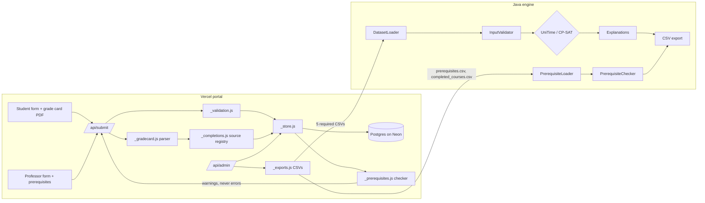
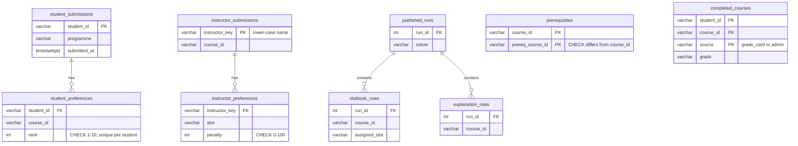

# Architecture (v3)

The Java engine's internal architecture is unchanged from [v2](../docs_v2/ARCHITECTURE.md). v3 replaces the portal's storage and adds a prerequisite path beside the solver.

`PrerequisiteChecker` runs on the student selections but its result never reaches `SOL`. The solver path is the v2 path, byte for byte.

## Portal layers

| Layer | Module | Rule |
|---|---|---|
| HTTP | `api/submit.js`, `admin.js`, `results.js`, `solver.js`, `health.js` | Parse the request, call validation and the store, map errors to status codes. No SQL. |
| Validation | `api/_validation.js` | Pure functions. Same rules as v2's Apps Script, plus prerequisite parsing. |
| Domain | `api/_gradecard.js`, `api/_prerequisites.js`, `api/_completions.js` | Pure except PDF reading. Shared rules with the Java side. |
| Storage | `api/_store.js` | The only SQL. Parameterised queries; one transaction per replacing write. |
| Connection | `api/_db.js` | Lazy `pg` pool from `DATABASE_URL`; TLS for non-local hosts; `setPool()` for tests. |
| Schema | `db/migrations/NNN_*.sql`, `db/migrate.js` | Applied once each, in order, each in its own transaction. |

Error mapping: `ValidationError` gives 400; a solver failure gives 502 with the solver's message; missing configuration gives 503. Anything else is logged and returned as a generic 500, so database errors never reach the browser.

## Schema

`prerequisites` and `completed_courses` are deliberately not foreign-keyed to submissions. A prerequisite may be declared before any student submits, and a completion record may arrive from a source other than the student (the reserved `admin` source).

## Prerequisite flow

1. A professor submits slot penalties with a course and a prerequisite list. The list replaces that course's earlier list, in the same transaction as the penalties. A missing field leaves the list unchanged; an empty field clears it.
2. A student submits a ranking and, optionally, a grade-card PDF (base64, at most 3 MB).
3. `_gradecard.js` rebuilds table cells from the PDF's text positions and reads each row by column. It returns course, grade and term for completed courses; U, W and I are dropped. The PDF, titles, name and roll number are discarded.
4. The preferences and parsed completions are saved in one transaction. With no new card, earlier completions are kept.
5. After saving, the checker reads **all** stored completions for the student, whatever their source, and returns warnings with the 200 response.
6. The admin snapshot recomputes warnings for every student and exports `prerequisites.csv`, `completed_courses.csv` and `prerequisite_warnings.csv`.
7. The CLI reads the first two files and must produce the same warnings: a golden file shared by both test suites enforces this.

## Extension point: admin-provided records

`api/_completions.js` maps a source id to an object with `fromSubmission(studentId, payload)`. To add academic-section records:

1. Add an `admin` entry that returns `{ completions: null, warnings: [] }`, since students supply nothing.
2. Add an admin action that writes `completed_courses` rows with `source = 'admin'`.
3. Set `COMPLETION_SOURCE=admin` if student uploads should be ignored, or keep `grade_card` to accept both.

No migration is needed: the `CHECK` already allows `'admin'`, and the checker already reads every source. The student form does not change.

## Why these choices

| Decision | Alternatives considered | Reason |
|---|---|---|
| Postgres on Neon | Supabase, Turso (SQLite), keep Sheets | Free tier, official Vercel integration, real constraints and transactions; plain `pg` driver keeps it portable |
| Server-side PDF parsing | Parse in the browser | One implementation, testable in Node. A self-upload is unverified either way, so client-side parsing would add no trust. |
| Warnings, not enforcement | Reject submissions | Agreed in P015. Grade cards are unverified, and prerequisites can be waived. |
| Prerequisite data outside `TimetableProblem` | Add fields to the problem | The solver cannot be influenced by it, and a test proves this. |
| Golden file for parity | Call Java from Node tests | Each CI job stays single-language; the contract is a reviewable file. |
